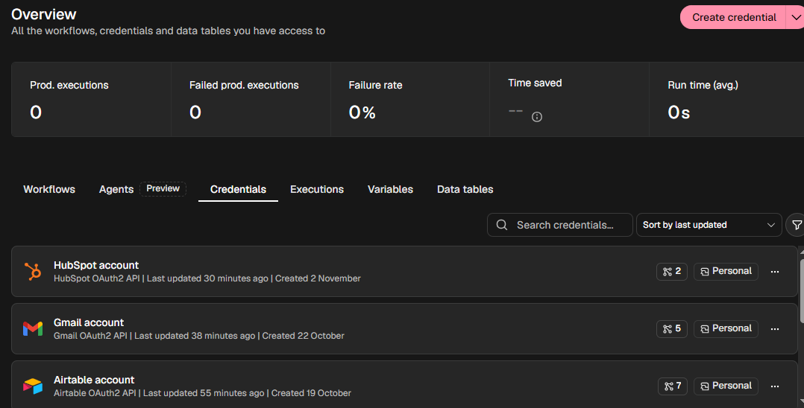
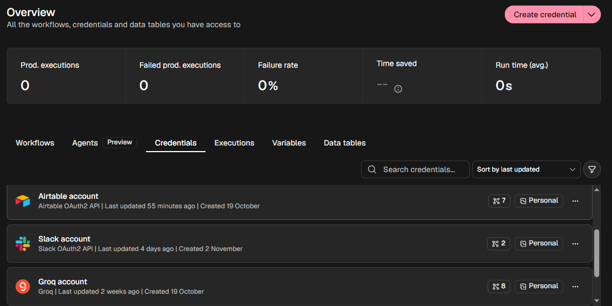
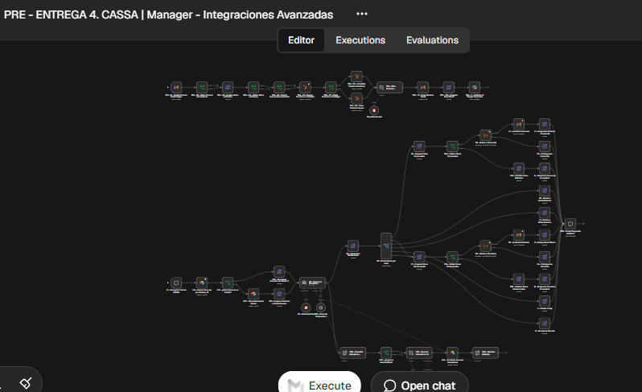
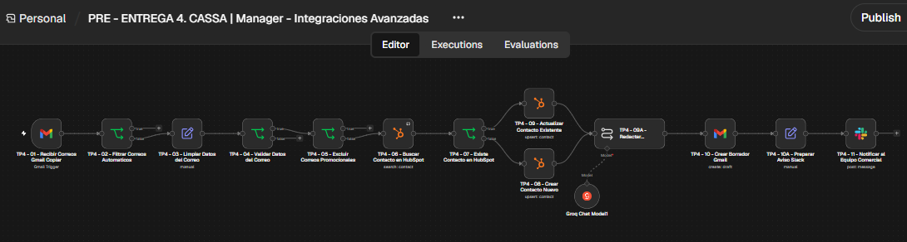

# Pre-entrega 4 | AI Automation Avanzado

**Proyecto de automatización de procesos con n8n**

## Descripción

Workflow desarrollado como parte de la carrera de AI Automation Avanzado de Coderhouse.

El proyecto integra inteligencia artificial, automatización de procesos y servicios externos para gestionar consultas comerciales, organizar información y optimizar la atención al cliente.

## Tecnologías utilizadas

- **n8n:** diseño y orquestación de workflows.
- **Groq:** procesamiento de consultas y generación de respuestas mediante modelos LLM.
- **Gmail:** recepción de correos y creación automática de borradores.
- **HubSpot:** búsqueda, creación y actualización de contactos.
- **Slack:** notificaciones internas.
- **Airtable:** almacenamiento y recuperación de memoria persistente.

## Funcionalidades principales

- Recepción y clasificación automática de consultas.
- Enrutamiento de solicitudes mediante el patrón *Triage & Delegate*.
- Validación de datos y filtrado de correos automáticos y promocionales.
- Búsqueda previa de contactos en HubSpot para evitar duplicados.
- Creación o actualización de contactos según corresponda.
- Generación de respuestas comerciales con inteligencia artificial.
- Creación de borradores en Gmail para revisión y aprobación humana (*Human-in-the-loop*).
- Notificaciones automatizadas al equipo mediante Slack.
- Memoria conversacional temporal y persistente, con consolidación periódica mediante IA.
- Derivación de solicitudes a subworkflows especializados.
- Ramas de auditoría y contingencia.

## Estructura del repositorio

- `checkpoint4_canzio_julieta.json`: archivo de exportación del workflow.
- `README.md`: documentación técnica y funcional del proyecto.

## Evidencia de funcionamiento

Se realizaron pruebas funcionales de:

- Recepción y procesamiento de correos mediante Gmail.
- Identificación y actualización de contactos existentes en HubSpot.
- Generación de respuestas mediante IA.
- Creación de borradores en Gmail sin envío automático.
- Envío de notificaciones al canal de Slack.
- Consolidación y recuperación de memoria persistente en Airtable.

La creación de contactos nuevos en HubSpot quedó pendiente de verificación mediante una prueba completa.

## Evidencia de integraciones

*Credenciales configuradas en n8n. Las claves y tokens de acceso no se publican.*

## Arquitectura del workflow

### Detalle del flujo de integraciones

## Instrucciones de importación

1. Importar `checkpoint4_canzio_julieta.json` desde n8n.
2. Configurar las credenciales de Gmail, HubSpot, Slack, Groq y Airtable.
3. Vincular los recursos externos necesarios, como la base de Airtable y el canal de Slack.
4. Configurar los subworkflows asociados y actualizar sus referencias.
5. Realizar pruebas de ejecución antes de activar el workflow.

## Seguridad

La versión pública del archivo se preparó sin claves API ni tokens de acceso.

Las credenciales y conexiones externas deben configurarse de forma independiente. El repositorio no incluye datos reales de clientes ni historiales de conversación.

## Autora

Julieta Canzio Otero

**Coderhouse | AI Automation Avanzado | 2026**
